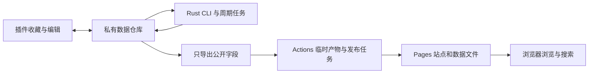

# TagMark V2 设计总览与验收清单

日期：2026-10-23。用户已在 Q48 确认更新后的设计。后续明确采用 grill-with-docs → to-spec → to-tickets → implement → code-review → retro 工作流。测试边界及项目技能配置已确认，规范已发布为 [Spec #1](https://github.com/pwnfan/tagmark-v2/issues/1)；当前进入 tickets 拆分审阅，尚未开始产品编码。完整规范见[开发规范](specs/tagmark-v2.md)。

## 首版要完成的用户流程

用户在桌面 Chrome 主动收藏 HTTP(S) 页面，先保存网址及允许采集的信息，无需手敲标签。插件支持离线录入，联网后与个人私有 GitHub 数据仓库同步。后台定时或手动处理自动分类、缺失定义和译文，以及 GitHub 仓库元信息；用户可在插件中检索、批量整理和修正结果，明确选择的收藏可在独立网站浏览和分享。

这是单人自部署工具，不设团队账号系统。首版不要求 V1 数据导入、旧 Python CLI 兼容、旧分享链接兼容、手机或普通网站编辑。V1 数据及长说明留在原项目。

## 组件与数据归属

| 部分 | 已确定职责 |
| --- | --- |
| Rust 核心与 CLI | 读取数据、选取待处理项、调用服务、检查链接、计算公开清单、验证结果、保护人工修改、合并写回及备份恢复；每批完成后退出 |
| Chrome 插件 | TypeScript strict＋React＋WXT；收藏、离线缓存、同步、编辑、批量管理及云端 Actions 触发 |
| 独立网站 | TypeScript strict＋React＋Vite；只读搜索和分享公开数据 |
| 共享部分 | 版本化数据契约、共同规则与行为样例，按需复用 React 组件；结构 schema 不能替代行为一致性检查 |
| 私有实例仓库 | 完整收藏、标签、译文、人工保护、公开规则、删除与冲突状态、任务进度、故障 Issue，以及私有工作流配置 |
| 公开 Pages 仓库 | 兼容 GitHub Free 的网站承载；通过 Actions 临时产物发布站点，收藏数据不进入公开 Git |

产品代码采用一个 monorepo；个人数据与部署配置独立。插件本地 IndexedDB 按记录存储，私有仓库采用 JSON/JSONL 快照，公开输出为紧凑 JSON＋gzip。密钥不属于收藏数据或备份；扩展仅保存用户允许的 GitHub 凭据，模型密钥由 CLI 环境或 Actions 管理。

## 收藏、标签与人工决定

- **网址身份**：完整 WHATWG URL 序列化去重，保留协议、查询串和片段的有意义区别。同址重复保存进入现有条目；稳定 ID 不随标题或网址变化。详见[边界样例](data-and-url-design.md)。
- **标签语义**：首版平面标签，有稳定 ID、英文标准名、英文短定义、打标规则以及英文和简体中文显示信息。按主题、用途与资源类型分类；偶然使用的编程语言留在 GitHub 元信息中筛选。
- **自动权限**：优先复用标签，可自动新增标签及定义。已有标签改名、合并、删除和语义边界变更由用户操作；旧名、同义词和译名用于检索同一标签。证据不足保留待处理原因。
- **人工保护**：每个标签关联和被编辑字段分别保护；拒绝的标签不被补回，手加的标签不被删除。普通重跑保留保护，显式解除所选保护后才重算。
- **译文**：英文原文改变后，未被人工修改的译文可更新；人工译文保留并提示复核。缺失译文回退英文。
- **同步冲突**：不同字段可以合并；同一内容的两份人工冲突保留双方，交给用户选择。迟到的自动结果不得覆盖较新的输入或人工决定。
- **删除与恢复**：收藏进入回收站；离线编辑可以保留供处理，但不能自动复活已删除条目。首版不自动清空回收站。整库备份包含完整 V2 状态而不含密钥，恢复到新空实例；单条恢复在原实例进行。

## 自动任务和模型路径

| 任务 | 初始默认值与边界 |
| --- | --- |
| 分类、缺失定义与译文 | 每 6 小时检查，增量处理；相关输入、规则变化或用户要求才重算既有结果 |
| GitHub 元信息 | 每天检查，每仓库 7 天过期，每轮最多 500 个仓库；按仓库去重，额度不足停止并留下续跑状态 |
| 链接可访问性 | 每天检查到期项，正常或失效链接每 7 天复查；首次 404/410 至少 24 小时后复核；普通网址每轮最多 500 个，GitHub 仓库主页复用元信息请求 |
| 立即执行 | CLI、本仓库 Actions 和插件一键触发；插件先同步相关修改，并区分已触发、运行中和已完成 |
| 本机 AI | Rust CLI 启动 codex exec，读取结构化结果，由核心校验落库；不建立本机 HTTP 常驻服务 |
| HTTP AI 调试 | 官方 deepseek-flash，20 条代表性收藏，对照 Codex；本次总预算 2 元，所有重试计入，不切换昂贵模型 |

GitHub 元信息由 API 直接获取，不由模型猜测。AI 只读取主动收藏页的标题、简介、允许的正文摘录及公开 GitHub README；不传私人备注、历史或 Cookie，正文可关闭，单条可跳过 AI。网页及 README 是待分类内容，不能成为覆盖系统规则或执行外部操作的指令。

统一政策覆盖全部 AI 编写和生成任务，包括分类、标签命名、短定义、打标规则、显示名及定义翻译，以及实际输出的说明文字。skill 包含或引用完整政策，API 任务从同一版本来源选用相应规则，不分别维护两套政策。新增 AI 生成字段必须先补齐其规则；这不意味着自动新增摘要或改写用户备注等功能。完整政策目录见[执行工作流](execution-workflow.md#完整-ai-政策的覆盖范围)。

程序控制可写范围、结果验证及并发合并，不能把一段 skill 提示词当成这些保障。长期模型、AI 批量与月预算在样本结果出来后确定；调试的 2 元不能被当作持续任务的循环预算。

认证失败或余额不足立即停止并挂起自动 AI，修复后由用户恢复；限流、断连、超时和服务端错误有限重试，每项请求在一次运行中最多尝试 3 次，含首次且计入预算。失败项不写入残缺结果，合格结果和续跑进度可保留，独立任务可继续，但 AI 失败必须在 CLI、Actions 和插件状态中如实显示。

首次未恢复故障在私有数据仓库创建 Issue 并提及配置的本人 GitHub 用户名；重复失败不反复开 Issue、评论或提及，恢复时关闭一次。安装时启用 Issues，通知工作流取得本仓库 issues:write。原生 Actions 通知可作为补充，最终送达仍受 GitHub 通知设置影响。详见 [API 故障决策](adr/0014-api-failure-recovery-notifications.md)。

## 编辑与公开展示

插件与网站界面首版支持英文、简体中文。检索覆盖中英文关键词、标签及别名，支持 AND/OR/NOT 和括号、GitHub 语言/星标/归档筛选及 V2 查询分享链接。插件另有批量标签、公开状态和删除操作，并区分本地未同步、同步冲突、任务失败及发布状态。

完整数据默认私有。公开字段仅为 URL、标题、公开条目用到的标签显示名与短定义、公开 GitHub 元信息，以及链接状态、简短原因和最近检查时间。私人备注、正文摘录、打标规则、AI 日志与回收站不进入公开数据。取消公开在下一次成功部署生效；发布失败不能显示为已撤回。

公开选择有三种基础模式：仅手动（默认）、包含指定标签再排除、全部减去指定标签。列表内部按任意一个标签匹配，空包含列表不会变成全部。每条收藏可以跟随规则、手动公开或手动私有；未设置公开性的标签保持中立。

**明确不公开的标签拥有一票否决权：只要命中一个，收藏就不能公开，手动公开也不能越过。** 最终顺序为：回收站排除 → 不公开标签排除 → 手动私有排除 → 手动公开 → 其余跟随基础模式。例如公开 rust、排除 private 时，rust＋tool 可公开，rust＋private 不公开。

规则保存前展示最终清单、数量及增删变化，每项说明入选或被阻止的原因。启用标签规则后，新增收藏或 AI／人工标签变化自动重算清单，下一次成功部署后更新网站；启用时明确提示这一行为。详见[公开清单决策](adr/0013-publication-selection-and-exclusion-veto.md)。

链接状态分为未检查、可访问、检查受阻／待复查、持续不可访问。404/410 至少两次且相隔至少 24 小时才自动标为持续不可访问；GitHub 404 不断言删除，可能是私有化或权限变化。登录限制、限流、超时和服务端错误先记为检查受阻；归档、禁用及长期不更新分别显示。用户可人工标记或解除失效，人工判断保留到明确解除。

失效不删除收藏、不自动取消公开，也不清空已有标题、标签或最后成功的元信息。分享网站默认仍展示，提供隐藏失效收藏的筛选。定期和立即复查可更新自动状态；重定向仅记录目标并提示，不自动修改网址或合并条目。完整规则见[链接状态决策](adr/0015-link-availability-and-rechecks.md)。

发布路径已确定：私有任务导出白名单数据为私有 artifact，触发公开仓库发布任务；公开任务下载指定导出，与网站文件一起部署为 Pages，再清理公开 artifact。前端直接读取 Pages 站点上的 JSON/gzip 文件，访客不需要登录 GitHub 或访问产物下载接口。

公开 Git 只保存站点配置及工作流等内容，不提交收藏数据，也不采用 amend 发布数据。交接需要公开仓库 Actions:write、私有源仓库 Actions:read；公开任务用本仓库 GITHUB_TOKEN 部署和清理，无需取得私有仓库 Contents 权限。短期公开 artifact 在清理前仍可能被下载，不承诺平台缓存或第三方副本可彻底清除。

## 分阶段交付与验收

以下为已确认的范围与验收分组；实际实施顺序由 to-tickets 的纵向功能切片及阻塞依赖决定，不直接按技术层拆票。需要真实账户或模型的部分，以相应环境配置可用为前提。

| 阶段 | 交付与退出条件 |
| --- | --- |
| 1. 核心契约与最短处理链路 | Rust CLI 可读取样本、执行校验和增量任务、输出可检查结果；Rust/TS 对 URL、人工保护、合并及公开清单的共同样例一致 |
| 2. 两条 AI 路径与费用验证 | 完整 AI 政策可供 skill 和 API 共用；20 条样本覆盖常见网页、GitHub 项目、歧义和证据不足；对照分类/定义/译文，报告错误和 token/耗时；DeepSeek 全部调用在 2 元总预算内 |
| 3. 插件与私有同步 | 可从空实例完成收藏、离线修改、同步、搜索、标签编辑、公开规则预览、冲突处理、回收站及备份到新空实例；两台客户端场景验证人工数据不丢失 |
| 4. Actions 与公开站点 | 自动任务可定时及一键触发，限额后续跑；API 失败、挂起恢复和私有 Issue 去重有效；链接状态可复查及筛选；仅发布白名单清单，排除标签不可被手动公开越过；取消公开后下一次成功部署移除；公开 Git 无收藏数据，清理部署产物后站点仍可访问 |
| 5. 可自行安装的发行包 | Windows x64、Linux x64/WSL、macOS x64/arm64 可执行文件运行验证；Chrome 插件包可开发者模式加载；英文/中文界面、安装和配置说明可用 |

必要的行为验收包括：HTTP/HTTPS 及片段区分、重复收藏保护人工内容；双方离线编辑不同字段与同字段冲突；删除后迟到编辑；AI 结果生成期间输入变化；手动拒绝标签不被恢复；原文变化后的人工译文；无效/截断模型输出；限流、中断及费用不足时不盲目重试；空实例备份恢复一致；私有字段不出现在公开数据、日志或发布包。

本轮补充验收：包含标签与不公开标签同时命中时不公开，即使手动公开；未设置标签保持中立；空包含列表、回收站及同标签同时包含/排除的结果正确；AI 改标签后按规则更新；401/402 挂起、三次尝试上限、同一故障只通知一次及恢复关闭；单次 404 不误判、连续 404 可复查、GitHub 私有化不标为已确认删除、归档仍可访问、人工状态不被覆盖、失效条目仍可公开并由访客筛选隐藏。

性能和模型质量报告基于实测；不以旧版 gzip 数据或模型文档代替 V2 测量。发布安装包不等于已经完成代码签名、商店上架或真实平台运行验证，各项实际完成情况需分别报告。

## 最终共同确认

用户在 Q39 要求调整的四部分已细化并回答；Q40–Q47 和后续“不公开标签一票否决”补充已纳入本文及 ADR 0013–0015。此前 Q41 中允许手动公开越过排除标签的方案已被替换。用户在 Q48 已确认更新后的设计并授权推进，随后要求先走完 to-spec 和 to-tickets，再进入 implement；设计确认不等于这些后续步骤已经完成。

长期模型与月预算属于样本验证后才能做的决策，不在当前没有证据时选定；其余可逆的目录命名、库版本和具体字段布局由上述约束推导并通过验收，不再另造产品要求。
