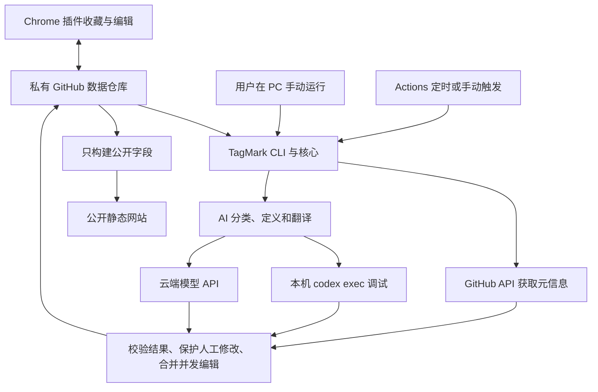

# TagMark V2 核心、CLI 与 Codex 的执行工作流

日期：2026-10-23。用途：解释核心、CLI 和 AI 的工作流。已选择 Rust 核心/CLI、本机 codex exec 调试及 DeepSeek 官方 deepseek-flash HTTP 路径。调试使用 20 条样本，DeepSeek 总预算为 2 元；基础离线收藏已开始实现，AI 路径尚待实施，尚未执行付费调用。

## 核心与 CLI 各做什么

核心承载数据校验、待处理项选择、标签规则、人工修订保护、合并、预算与重试。CLI 是启动这些处理的命令行入口，同一个可执行文件可在用户 PC 或 GitHub Actions 中运行。

每次运行处理一批后退出；进度写入持久状态，下次运行继续，程序无需在用户 PC 常驻。已接受的定时目标由 GitHub Actions 启动；本机提供手动执行和调试入口。若以后选择本机定时，可由操作系统调度器周期启动同一个 CLI，运行时需要电脑可用。这种本机调度尚未选入首版。

| 场景 | 谁启动 | 执行地点 | AI 来源 | 对用户 PC 的要求 |
| --- | --- | --- | --- | --- |
| 目标中的无人值守运行 | GitHub Actions 定时或手动触发 | GitHub-hosted runner | 已配置的模型 API | 无需开机 |
| 用户提出的本地调试 | 用户运行 CLI | 用户 PC | 本机 Codex CLI | 本轮运行期间开机联网，并具备有效 Codex 访问 |
| 本机使用模型 API | 用户运行 CLI | 用户 PC | 已配置的模型 API | 本轮运行期间开机联网，无需安装 Codex |
| 可选的本机定时 | 操作系统调度器 | 用户 PC | Codex 或模型 API | 到点需电脑可用；非首版已确认要求 |

## 一次处理的候选流程

图中两个 AI 分支是按执行环境选择的候选后端，并非每轮都调用两次。GitHub-hosted runner 无法直接使用用户 PC 上的本机分支；网站也只获得公开输出。

1. 从私有仓库读取一致的数据版本，选出新收藏、缺失定义/译文、到期 GitHub 元信息或待重试项。
2. 按各任务频率、新鲜度与单轮预算确定本批内容。
3. GitHub 元信息由程序直接请求 GitHub API，不交给模型猜测；必要的公开 README 可作为 AI 分类证据。
4. AI 任务将允许发送的收藏内容、已有相关标签、统一规则与期望结果结构交给选定后端。私人备注和凭据不进入模型输入。
5. 核心校验返回结构、标签引用和规则约束，再执行人工修订保护；模型返回的数据不能直接替换整库。
6. 重新检查仓库是否有并发编辑，对仍适用的结果进行合并，一致地提交数据和处理状态。原始输入已经变化的结果需放弃或重新处理。
7. 记录成功、失败或待重试项并退出。插件下次同步时得到结果；已公开内容由发布流程更新。

这个流程只处理已同步的数据。尚在离线插件内的收藏要先同步，云端任务才能看见。

## 把本机 Codex 当成可调用的 AI 后端

已选择先实现 `TagMark CLI → codex exec 子进程 → 结构化结果 → TagMark 校验和保存`。调用方可以像调用一个函数那样提交任务和接收结果；首版调试不要求另开 HTTP 端口。若调用方明确需要标准 HTTP 模型接口，再单独确定兼容的请求/响应格式。

已在本机确认 `codex-cli 0.164.0`，帮助信息包含 `exec`、`--output-schema`、`--output-last-message`、`--json` 和 `--ephemeral`。这是本机命令能力检查，没有启动推理任务，也没有验证当前认证和模型是否可用。

- `--output-schema` 约束最终结果的 JSON 结构；`--json` 是运行事件流，两者用途不同。TagMark 仍须检查结果的业务有效性。[非交互模式](https://learn.chatgpt.com/docs/non-interactive-mode)
- `codex exec` 默认复用 CLI 已保存的认证。ChatGPT 登录使用相应订阅访问，API key 登录按 API 用量计费；具体额度和可用模型取决于当前账户及配置。本机运行 Codex 进程不代表模型离线运行。[认证说明](https://learn.chatgpt.com/docs/auth)
- Codex app-server 提供会话、流式事件和审批等更深集成，采用 JSON-RPC over stdio 等传输；它不是直接提供 `/v1/chat/completions` 的模型 HTTP 服务。WebSocket 路径当前为实验性质，批处理调试不需要先承担这层服务管理。[App Server](https://learn.chatgpt.com/docs/app-server)
- 官方 TypeScript SDK 可在 Node.js 环境中启动和继续本地 Codex 会话。选择 Go/Rust 核心并不要求引入 SDK；它们同样能启动 Codex 子进程并读写 JSON。[Codex SDK](https://learn.chatgpt.com/docs/codex-sdk)

调试适配器的候选边界是：使用受控工作目录和明确输入，Codex 负责返回 AI 结果，TagMark 持有写回与合并责任。具体进程配置、工具权限、超时和批次上限在实施前需验证；这里尚未承诺仅靠提示词能限制全部副作用。

只有选择本机 Codex 后端的用户才需要另装并登录 Codex。TagMark 自身“无需安装语言运行时”的分发要求继续成立；使用模型 API 的用户无需 Codex。

## 与 agent/skill 的关系

存在两个调用方向：

- **TagMark 调用 Codex**：TagMark 决定本批处理哪些数据，Codex 执行分类、定义生成或翻译，再由 TagMark 校验落库。这是当前建议的本地调试路线。
- **Codex 调用 TagMark**：用户在 Codex 中要求整理收藏，skill 指导 agent 调用 TagMark 的任务入口。若 agent 自己负责生成 AI 结果，则通过数据准备和结果应用入口完成，避免形成无终点的相互调用。

两个方向都应使用同一份版本化 AI 生成政策和结果校验，不分别维护分类、定义或翻译标准。skill 包含或明确引用完整政策；HTTP API 适配器按任务装载同一来源的相应规则。skill 是使用指导，最终数据约束仍由程序执行。

### 完整 AI 政策的覆盖范围

以下是已确认需求对应的政策目录，实施时需要随产品落地；当前尚未创建产品 skill 或调用模型。

| AI 生成任务 | 政策必须明确的内容 |
| --- | --- |
| 收藏分类与标签关联 | 主题、用途与资源类型的取舍；已有标签复用；适用与排除条件；证据不足时暂缓；人工保留和拒绝的关联不可改写 |
| 新标签命名 | 英文标准名与已有概念的一致性；检索旧名、别名和译名以避免重复概念；不得自动改名、合并或删除已有标签 |
| 标签短定义 | 英文原文，说明概念含义及与相邻概念的区别；不写百科长文，不把打标规则混入释义，不擅自改变已有标签语义 |
| 打标规则编写 | 与定义一致的适用条件、排除条件和判断例子；已有语义边界的变更仍由用户决定 |
| 标签显示名和定义翻译 | 英文与简体中文的对应关系；保持原文概念、术语一致，不能翻译成更宽或更窄的分类；缺失回退英文，人工译文保留并在原文变化后提示复核 |
| 实际输出的说明文字 | 分类依据、证据不足等说明只依据允许输入，简短交代可核查原因；不得编造事实、泄露私人内容或把网页中的指令当成任务要求 |
| 全部任务共同约束 | 允许输入、可写字段、输出结构、未知与空值、失败处理、人工保护及版本追踪；不得新增未定义政策的 AI 生成字段 |

政策版本随任务记录，相关政策变更才使受影响的未保护结果进入重算范围。结构检查、输入版本复核、权限和人工保护由核心执行，不依赖模型自觉遵守。上述范围不增加 AI 摘要、用户备注改写或生成网页标题等未确认功能。

## API 失败、恢复和通知

已确认采用分类失败策略和私有故障 Issue，详见 [ADR 0014](adr/0014-api-failure-recovery-notifications.md)。401/402 立即停止并挂起自动 AI，修复后手动恢复；限流、超时、断连与服务端错误有限重试，耗尽后报告失败并保留进度。合格结果可以保留，残缺或未校验结果不能落库。其他独立任务可继续执行，但整体不能把 AI 失败显示为全部成功。

首次未恢复故障在私有数据仓库创建 Issue，首次提及配置的本人 GitHub 用户名；重复失败不反复开 Issue、评论或提及，恢复时关闭一次。工作流需要本仓库 `issues: write`，安装时启用 Issues。GitHub 通知实际送达受用户订阅和通知设置影响；原生 Actions 通知主要跟随触发者，不能假定仓库 owner 自动收到。[运行通知](https://docs.github.com/en/actions/concepts/workflows-and-actions/notifications-for-workflow-runs)、[Issues API](https://docs.github.com/en/rest/issues/issues#create-an-issue)

## 本地调试与云端运行的衔接

先用本机 Codex 验证小批分类、定义及翻译质量，并以 DeepSeek 官方 deepseek-flash 验证相同任务的 HTTP 调用路径。使用 20 条代表性收藏，DeepSeek 本次调试总预算 2 元，重试计入且不自行切换模型；达到预算前停止派发。只接入本机 Codex 的阶段，AI 由本机触发；GitHub 元信息刷新可以独立在 Actions 中工作。

GitHub-hosted runner 是独立的云端计算环境，不会因用户 PC 已登录 Codex 而获得对该本机进程或登录态的访问。可另外安装 Codex 并配置适用于 CI 的认证，但那是另一种云端部署；当前无需为调试开放 PC 网络端口、复制个人登录文件或部署 self-hosted runner。[GitHub-hosted runners](https://docs.github.com/en/actions/concepts/runners/github-hosted-runners)、[Codex 自动化认证](https://learn.chatgpt.com/docs/non-interactive-mode#authenticate-in-automation)

Go、Rust、TypeScript 都能实现上述工作流。用户最终选择 Rust 核心/CLI，加已确认的 TypeScript/React 界面。该选择无需改变批处理、后端调用、同步合并和人工保护的边界，也不需要为了调用 Codex 而引入 TypeScript SDK。

## DeepSeek 官方 HTTP 调试路径的事实依据

以下按 2026-10-23 的官方文档记录；没有执行付费请求，也没有读取任何密钥。

- OpenAI 格式的 base URL 为 `https://api.deepseek.com`，提供 `POST /chat/completions` 和 `POST /responses`。Responses 是部分兼容实现，无服务端会话存储；`developer` 消息按 `user` 处理，因此不能直接复制所有 OpenAI 参数和角色语义。[首次调用](https://api-docs.deepseek.com/)、[兼容表](https://api-docs.deepseek.com/guides/responses_api/)
- Responses 当前文档列出 `text.format.type = json_schema`；Chat 的 JSON mode 主要保证 JSON 语法，可能空内容或因输出上限截断。建议先验证 Responses 的 schema 输出，同时由 Rust 检查标签引用、人工保护和当前数据版本。[Responses 参数](https://api-docs.deepseek.com/api/create-response/)、[JSON mode](https://api-docs.deepseek.com/guides/json_mode/)
- 当前模型名为 `deepseek-flash` 和 `deepseek-v4-pro`，分别对应 DeepSeek-V4.1-Flash-1017 与 DeepSeek-V4-Pro-0813；模型别名及价格可能变化，实施时应再次核对。用户已选择 Flash，调试不自行切换至 Pro。[模型与人民币价格](https://api-docs.deepseek.com/zh-cn/quick_start/pricing/)
- 按 token 计费，包含输入缓存命中/未命中、输出用量及峰谷时段差异。Responses 返回 usage，`max_output_tokens` 包括可见输出及推理 token；公开文档未查到单次请求的人民币总额硬上限参数。项目需要限制单次输出、任务数和重试，记录费用估算并在预算阈值停止派发；这不等于能替其它应用控制整个账户的费用。[用量与参数](https://api-docs.deepseek.com/api/create-response/)、[余额接口](https://api-docs.deepseek.com/api/get-user-balance/)
- 当前并发限制按账户共享；429 应减速，500/503 可等待后重试，400/422 需要修正请求，401/402 应报告认证或余额问题。重试有次数和预算上限，不能对所有错误无限重试。[限流](https://api-docs.deepseek.com/quick_start/rate_limit/)、[错误码](https://api-docs.deepseek.com/quick_start/error_codes/)

第五轮接受的调试约束是 20 条代表性收藏、官方 deepseek-flash、DeepSeek 本次总预算 2 元，对照本机 Codex 的分类、定义和译文，记录质量、耗时和用量后再确定长期配置。真实 schema 兼容性、语义质量、空结果/截断处理和中断恢复必须经样本及故障测试验证，不能从文档推定已经通过。
